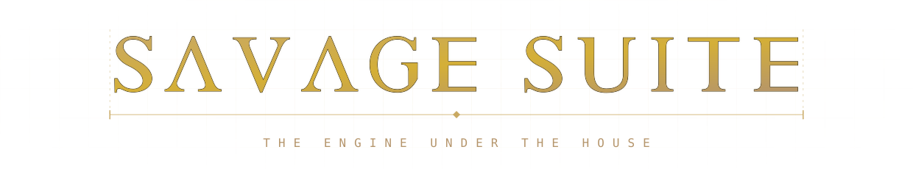
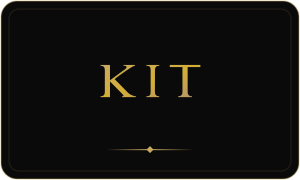
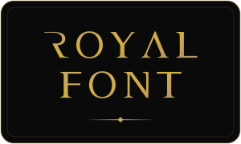
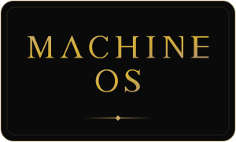
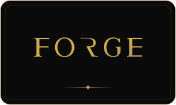
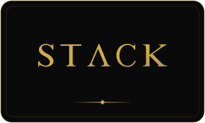
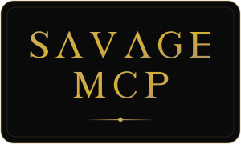
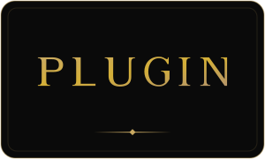
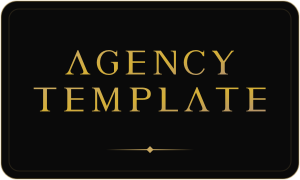

<!--
  ┌─────────────────────────────────────────────────────────────────────┐
  │  GENERATED FILE — do not edit this README by hand.                  │
  │  Edit  data/profile.json · data/properties.json · the template,     │
  │  then run:   node scripts/build-profile.mjs                         │
  │  (the GitHub Action rebuilds it automatically on push to main).     │
  └─────────────────────────────────────────────────────────────────────┘
-->

<div align="center">



<em>One skin, one kit, one contract — the engine every face in the house runs on.</em>


<p></p>

<table>
  <tr>
    <td align="center" valign="top" width="176">
      <br/>
      <sub>Design system</sub>
    </td>
    <td align="center" valign="top" width="176">
      <br/>
      <sub>Copy-in modules</sub>
    </td>
    <td align="center" valign="top" width="176">
      <br/>
      <sub>Contract</sub>
    </td>
    <td align="center" valign="top" width="176">
      <br/>
      <sub>House display face</sub>
    </td>
    <td align="center" valign="top" width="176">
      <br/>
      <sub>AI OS spine</sub>
    </td>
  </tr>
  <tr>
    <td align="center" valign="top" width="176">
      <br/>
      <sub>Data</sub>
    </td>
    <td align="center" valign="top" width="176">
      <br/>
      <sub>Law + ops vault</sub>
    </td>
    <td align="center" valign="top" width="176">
      <br/>
      <sub>Photo pipeline</sub>
    </td>
    <td align="center" valign="top" width="176">
      <br/>
      <sub>Build template</sub>
    </td>
    <td align="center" valign="top" width="176">
      <br/>
      <sub>Agents</sub>
    </td>
  </tr>
  <tr>
    <td align="center" valign="top" width="176">
      <br/>
      <sub>Tooling</sub>
    </td>
    <td align="center" valign="top" width="176">
      <br/>
      <sub>Widget</sub>
    </td>
    <td align="center" valign="top" width="176">
      <a href="https://agency-template-mu.vercel.app"></a><br/>
      <sub>Model-site template</sub>
    </td>
  </tr>
</table>


### The packages

| Package | Role | Where | Status | Repo |
|:--|:--|:--|:--:|:--:|
| **Skin** | Design system | @savage-suite/skin | 🔒 Private | `SAVAGE-SKIN` |
| **Kit** | Copy-in modules | feature modules | 🔒 Private | `SAVAGE-KIT` |
| **Contracts** | Contract | cross-repo wire | 🔒 Private | `SAVAGE-CONTRACTS` |
| **Royal Font** | House display face | MBF Royal | 🔒 Private | `ROYAL-FONT` |
| **Ledger** | AI OS spine | client conversations | 🔒 Private | `SAVAGE-LEDGER` |
| **Relay** | Data | ingest + read layer | 🔒 Private | `SAVAGE-RELAY` |
| **Machine OS** | Law + ops vault | the brain | 🔒 Private | `SAVAGE-MACHINE-OS` |
| **Forge** | Photo pipeline | shoot → master | 🔒 Private | `SAVAGE-FORGE` |
| **Stack** | Build template | dev container | 🔒 Private | `savage-stack` |
| **SAVAGE MCP** | Agents | Hermes-facing servers | 🔒 Private | `GRAM-BOT` |
| **Plugin** | Tooling | Claude Code | 🔒 Private | `savage-plugin` |
| **Onyx Widget** | Widget | client feedback | 🔒 Private | `SAVAGE-ONYX` |
| **Agency Template** | Model-site template | [agency-template-mu.vercel.app ↗](https://agency-template-mu.vercel.app) | 🟢 Live | `AGENCY-TEMPLATE` |

<sub>🟢 Live&nbsp;&nbsp;·&nbsp;&nbsp;🔒 Private&nbsp;&nbsp;—&nbsp;&nbsp;names link to the live site.</sub>

<br/>

```text
┌─────────────────────────────────────────────────────┐
│          ONE SKIN · ONE KIT · ONE CONTRACT          │
│   TOKENS OUTRANK DOCS · GOLD IS FOIL, NEVER PAINT   │
└─────────────────────────────────────────────────────┘
```

<br/>


<sub>THE ENGINE ROOM · PRIVATE PACKAGES · BUILT FOR THE HOUSE</sub>

<sub><a href="https://github.com/savageceo">SAVAGE CEO</a>&nbsp;&nbsp;·&nbsp;&nbsp;<a href="https://github.com/SAVAGE-STUDIO-INC">SAVAGE STUDIO</a>&nbsp;&nbsp;·&nbsp;&nbsp;<a href="https://github.com/SAVAGE-ROSTER">SAVAGE ROSTER</a>&nbsp;&nbsp;·&nbsp;&nbsp;<b>SAVAGE SUITE</b>&nbsp;&nbsp;·&nbsp;&nbsp;<a href="https://github.com/SAVAGE-CITY">SAVAGE CITY</a>&nbsp;&nbsp;·&nbsp;&nbsp;<a href="https://github.com/SAVAGE-BUNNY">SAVAGE BUNNY</a>&nbsp;&nbsp;·&nbsp;&nbsp;<a href="https://github.com/SAVAGE-CLIENTS">SAVAGE CLIENTS</a>&nbsp;&nbsp;·&nbsp;&nbsp;<a href="https://github.com/GHOST-CROWN">GHOST CROWN</a></sub>

<p>
  <a href="https://github.com/SAVAGE-SUITE"></a>
</p>

</div>
